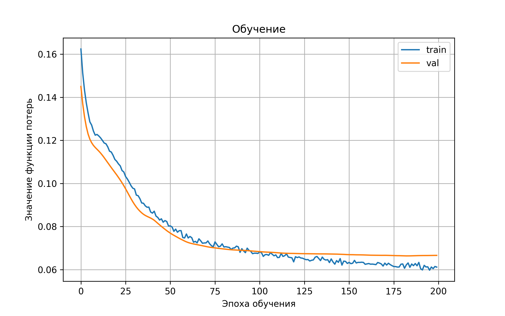
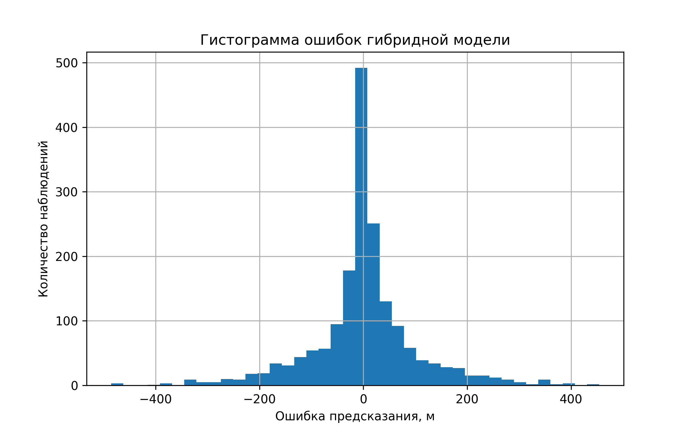
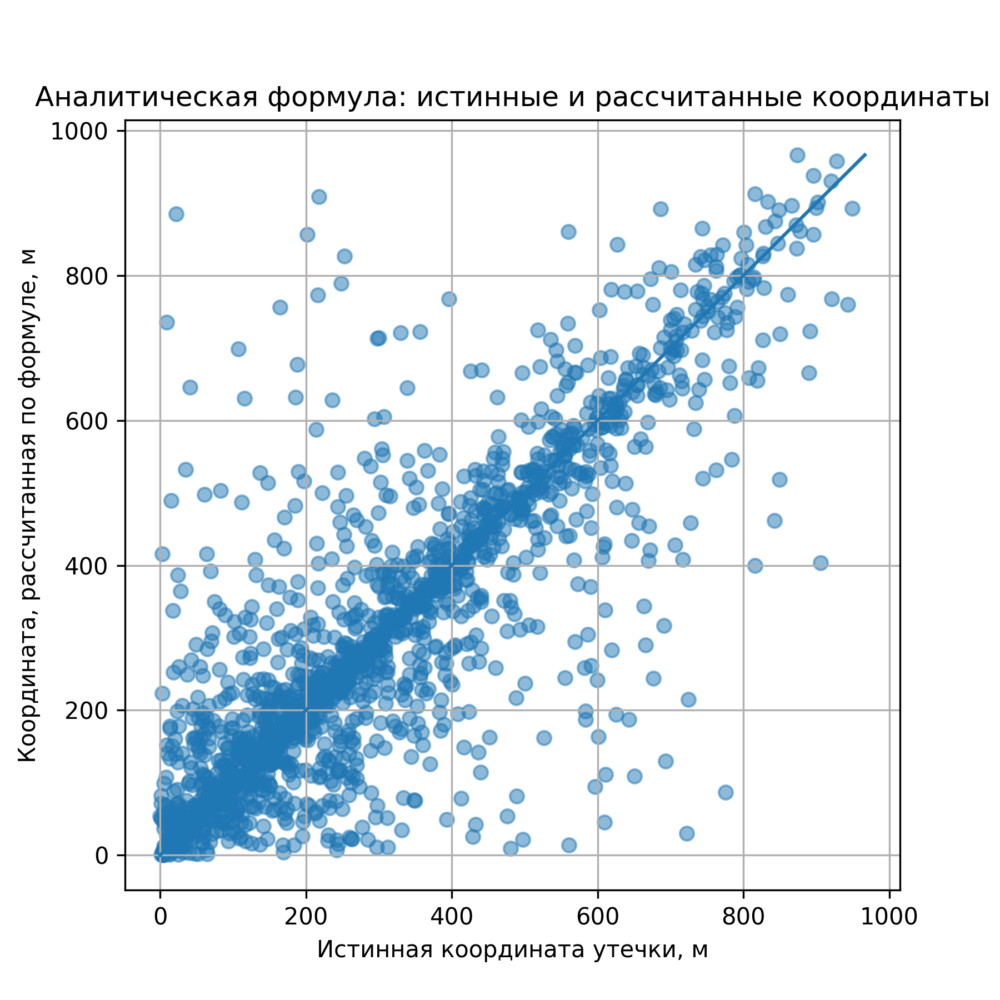
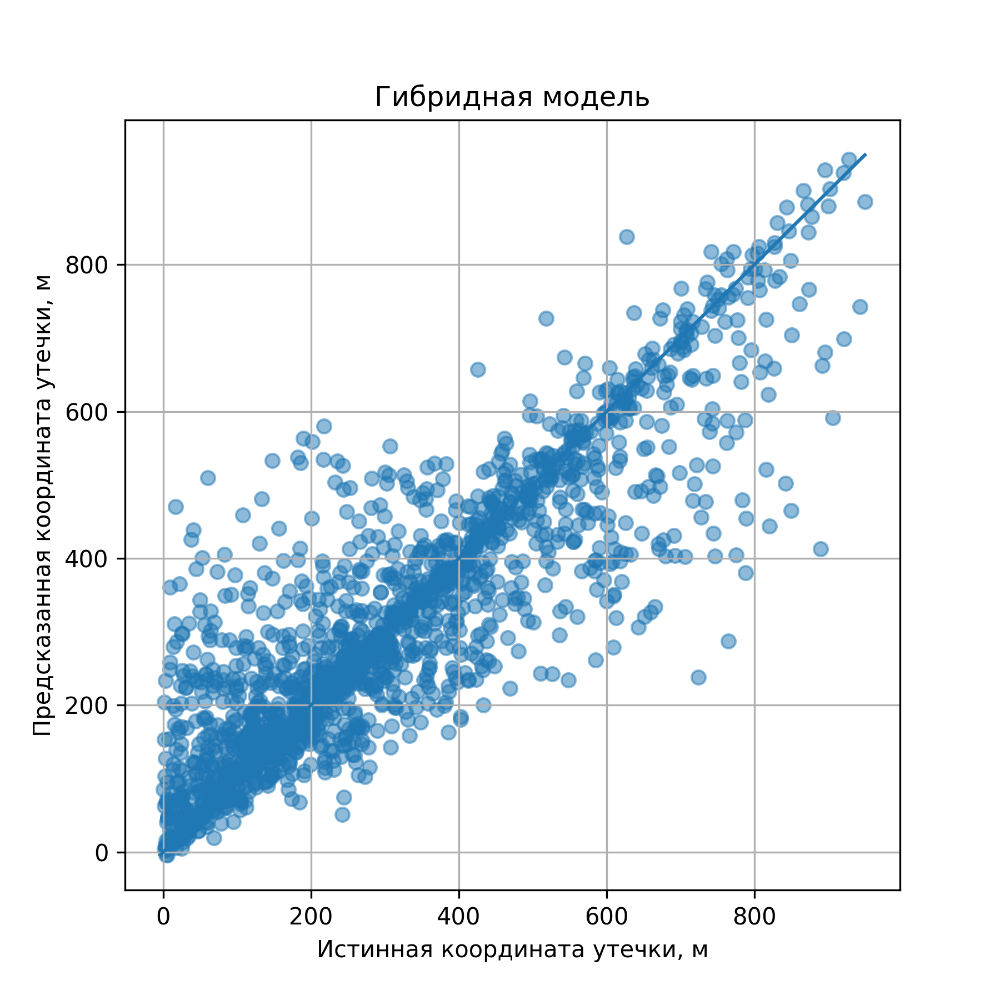

# Локализация утечки газа в трубопроводе

**Гибридный подход на основе физической модели и машинного обучения для определения координаты утечки по зашумлённым измерениям давления и расхода газа.**


## О проекте

Проект посвящён **локализации одиночной утечки газа** в трубопроводе. По измерениям давления и объёмного расхода на входе и выходе, геометрии трубы и физическим характеристикам газа требуется оценить координату утечки $x \in [0, L]$, отсчитываемую от начала трубопровода.

Вместо замены физики «чёрным ящиком» здесь объединены три компонента:

1. **Упрощённая физическая модель** течения газа, позволяющая аналитически оценить координату утечки.
2. **Генератор синтетических данных**, моделирующий параметры трубопровода, положение утечки и шум измерительных датчиков.
3. **Многослойный перцептрон (MLP)**, обучающийся предсказывать *поправку* к аналитической оценке.

Таким образом, реализована **гибридная регрессионная модель с опорой на физические закономерности** (*physics-guided machine learning*). Это подход с корректировкой результата физической формулы на основе данных, **а не** физически информированная нейросеть (*PINN*), в функцию потерь которой включены дифференциальные уравнения.

## Метод решения


### 1. Физическая модель и аналитическое решение

В файле `physics.py` вычисляются скорость течения газа и число Рейнольдса:

$$
v = \frac{4Q}{\pi d^2}, \qquad
Re = \frac{d v \rho_0}{\eta}
$$

где:

- $Q$ — объёмный расход газа;
- $d$ — внутренний диаметр трубы;
- $\rho_0$ — плотность газа;
- $\eta$ — динамическая вязкость.

**В текущем коде** используются следующие зависимости для коэффициента трения и коэффициента сопротивления трубопровода:

$$
\lambda = 0.067 \left(\frac{158}{Re} + \frac{2k_e}{d}\right)^{0.2},
\qquad
k = \frac{626.1\,\rho_0\lambda}{d^5}
$$

Здесь $k_e$ — абсолютная шероховатость трубы. Реализация использует **одну корреляционную формулу**, а не отдельные зависимости для ламинарного и турбулентного режимов.

При генерации сценария с истинной координатой утечки $x_{\mathrm{true}}$ давление на выходе вычисляется по формуле:

$$
P_{\mathrm{end}} = P_{\mathrm{start}} - k\left[x_{\mathrm{true}}(Q_{\mathrm{start}}^2-Q_{\mathrm{end}}^2)+LQ_{\mathrm{end}}^2\right]
$$

Выразив координату утечки, получаем **аналитическую оценку**:

$$
\boxed{
x_{\mathrm{formula}} =
\frac{(P_{\mathrm{start}}-P_{\mathrm{end}})/k - LQ_{\mathrm{end}}^2}
{Q_{\mathrm{start}}^2-Q_{\mathrm{end}}^2}
}
$$

Аналитическая формула применяется к **зашумлённым измерениям**. Поэтому её погрешность зависит от ошибок датчиков. Используемые уравнения описывают упрощённую модель: её точность для реальных газотранспортных систем в рамках проекта не подтверждена.

### 2. Генерация синтетического датасета

Модуль `dataset.py` по умолчанию формирует **12 000 наблюдений** с `seed=42`. Каждое наблюдение соответствует одному сценарию эксплуатации трубопровода с утечкой.

| Параметр | Диапазон при генерации |
| --- | --- |
| Длина трубопровода $L$ | 200–1 000 м |
| Диаметр трубы $d$ | 0,3–0,8 м |
| Плотность газа $\rho_0$ | 0,65–0,85 кг/м³ |
| Динамическая вязкость $\eta$ | $1{,}2\times10^{-5}$–$1{,}8\times10^{-5}$ Па·с |
| Шероховатость $k_e$ | $1\times10^{-5}$–$3\times10^{-5}$ м |
| Расход на входе $Q_{\mathrm{start}}$ | 1–5 м³/с |
| Доля газа, выходящего через утечку | 2–20% входного расхода |
| Давление на входе $P_{\mathrm{start}}$ | 3–7 МПа |
| Истинная координата $x_{\mathrm{true}}$ | Равномерное распределение на отрезке от 0 до $L$ |
| Относительная погрешность измерений | До ±1% для каждого измерения давления и расхода |

Для каждого сценария генератор рассчитывает расход и давление на выходе, добавляет шум к измеряемым давлениям и расходам, проверяет физические ограничения и вычисляет координату по аналитической формуле. Сценарии с недопустимыми значениями или с аналитической оценкой за пределами трубы исключаются. **Эта фильтрация влияет на распределение итогового датасета.**

В датасет входят исходные измерения, физические коэффициенты, производные признаки (в том числе разности давлений и расходов), аналитическая оценка и истинная координата утечки. Данные сохраняются в `data/dataset.csv`.

### 3. Нейросеть для коррекции аналитической оценки

Нейросеть предсказывает не саму координату $x_{\mathrm{true}}$, а **нормированную ошибку аналитического решения** (*residual learning*):

$$
y = \frac{x_{\mathrm{true}}-x_{\mathrm{formula}}}{L}
$$

Итоговая оценка получается добавлением предсказанной поправки к результату физической модели:

$$
\boxed{\hat{x} = x_{\mathrm{formula}} + L\,\hat{y}}
$$

Модель использует **17 входных признаков**: измеренные давления и расходы, геометрию трубы, характеристики газа, производные разности и нормированную аналитическую оценку.

**Важное ограничение:** два признака — `noise_level` и `leak_fraction` — доступны генератору синтетических сценариев, но в реальных условиях обычно не известны заранее. Подробнее — в разделе [«Ограничения и дальнейшее развитие»](#ограничения-и-дальнейшее-развитие).

| Компонент | Реализация |
| --- | --- |
| Модель | Полносвязный многослойный перцептрон `LeakNet` |
| Архитектура | 17 → 64 → 64 → 32 → 1 |
| Активации скрытых слоёв | ReLU |
| Регуляризация | Dropout 0,2 после первых двух скрытых слоёв |
| Выход | Линейный, нормированная поправка (без Sigmoid) |
| Предобработка | `StandardScaler`, обучаемый только на обучающей выборке |
| Оптимизатор | Adam, скорость обучения $10^{-3}$ |
| Обучение | 200 эпох, полнобатчевая оптимизация |
| Функция потерь | Взвешенная среднеквадратичная ошибка |

Функция потерь придаёт больший вес наблюдениям с большой аналитической ошибкой:

$$
\mathcal{L} = \frac{1}{N}\sum_{i=1}^{N}
\left(1+5\lvert y_i\rvert\right)(\hat{y}_i-y_i)^2
$$

Данные разбиваются на **обучающую (70%), валидационную (15%) и тестовую (15%)** выборки с `random_state=42`. Стандартизатор обучается только на обучающей части, после чего применяется к валидационной и тестовой. При наличии CUDA используется GPU, иначе — CPU.

## Оценка качества

Для оценки регрессии используются:

- **MAE** (*Mean Absolute Error*) — средняя абсолютная ошибка;
- **RMSE** (*Root Mean Squared Error*) — корень из среднеквадратичной ошибки;
- **R²** (*Coefficient of Determination*) — коэффициент детерминации.

Приведённые ниже значения **повторно рассчитаны по сохранённым весам `result/model.pth`** на датасете с `seed=42`. Стандартизатор восстановлен по обучающей выборке. Обе модели сравниваются **на одних и тех же 1 800 наблюдениях тестовой выборки**.

| Метод | MAE ↓ | RMSE ↓ | R² ↑ |
| --- | ---: | ---: | ---: |
| Аналитическая формула | 70,909 м | 125,035 м | 0,6563 |
| Гибридная модель с MLP | **65,498 м** | **103,080 м** | **0,7664** |

На этой тестовой выборке гибридный подход снижает MAE примерно на **7,6%**, а RMSE — на **17,6%** по сравнению с аналитическим решением. Более заметное улучшение RMSE может указывать на уменьшение крупных ошибок, однако существенные отклонения сохраняются.

**Особенность текущей оценки:** в `main.py` метрики аналитической формулы выводятся **по всему датасету**, а метрики гибридной модели — **по тестовой выборке**. Напрямую сравнивать такие результаты некорректно. В таблице выше использована единая тестовая выборка. При повторном обучении значения могут измениться, поскольку случайность PyTorch зафиксирована не полностью.

### Визуализация результатов

| Ошибка на обучении и валидации | Распределение ошибок предсказания |
| --- | --- |
|  |  |

| Аналитическая формула и истинная координата | Гибридная модель и истинная координата |
| --- | --- |
|  |  |

Графики формируются в `main.py` и сохраняются в `figures/`.

## Запуск проекта

**Требования:** Python 3, pip и окружение, в котором можно установить PyTorch.

Создайте виртуальное окружение:

```bash
python -m venv .venv
```

Активируйте его в Windows PowerShell:

```powershell
.\.venv\Scripts\Activate.ps1
```

Или в Linux/macOS:

```bash
source .venv/bin/activate
```

Установите зависимости:

```bash
python -m pip install numpy pandas matplotlib scikit-learn torch
```

Сгенерируйте датасет, обучите модель, оцените качество и сохраните графики:

```bash
python main.py
```

При необходимости скрипт создаёт каталоги `data/`, `figures/` и `result/`. Также вызывается `plt.show()`, поэтому для интерактивного отображения графиков может потребоваться графическое окружение.

### Результаты выполнения

| Путь | Содержимое |
| --- | --- |
| `data/dataset.csv` | Синтетические наблюдения и целевые координаты |
| `result/model.pth` | Веса нейросети PyTorch (`state_dict`) |
| `figures/train.png` | График взвешенной ошибки на обучении и валидации |
| `figures/formula.png` | Аналитическая оценка относительно истинной координаты |
| `figures/hybrid.png` | Прогноз гибридной модели относительно истинной координаты |
| `figures/errors.png` | Распределение ошибок гибридной модели |

> **Примечание:** `model.pth` содержит только веса нейросети. Обученный стандартизатор и порядок входных признаков **не сохраняются**, поэтому текущий checkpoint ещё не является полностью автономным артефактом для инференса.

## Структура репозитория

```text
.
├── physics.py                 # Физическая модель и аналитическая оценка
├── dataset.py                 # Генерация синтетических сценариев
├── model.py                   # Архитектура нейросети на PyTorch
├── train.py                   # Обучение и взвешенная MSE
├── main.py                    # Полный эксперимент и визуализация
├── data/                      # Датасет после запуска
│   └── dataset.csv
├── figures/                   # Графики эксперимента
│   ├── train.png
│   ├── formula.png
│   ├── hybrid.png
│   └── errors.png
└── result/
    └── model.pth              # Сохранённые веса модели
```

## Ограничения и дальнейшее развитие

Проект — **исследовательский прототип (proof of concept)**, а не проверенная промышленная система обнаружения утечек.

1. **Оценка только на синтетических данных.** Датасет создаётся с помощью той же упрощённой физической модели, на которой основана аналитическая формула. Переносимость результатов на реальные трубопроводы, дрейф датчиков, другие режимы течения и условия за пределами обучающего распределения не исследована.
2. **Признаки, доступные только в симуляторе.** `noise_level` и `leak_fraction` берутся из генератора, а не оцениваются по доступным измерениям. Их использование способно завысить ожидаемое качество на реальных данных. Следующий шаг — удалить или заменить их признаками, доступными при эксплуатации, после чего заново обучить и проверить модель.
3. **Смещение выборки из-за фильтрации.** Генератор исключает сценарии, в которых измерения нарушают ограничения или аналитическая оценка выходит за границы трубы. В итоге сложные случаи могут быть представлены недостаточно.
4. **Воспроизводимость и сравнение моделей.** Необходимо зафиксировать генераторы случайных чисел PyTorch, оценить разброс результатов между запусками, сравнивать baseline и ML на одной тестовой выборке, сохранять конфигурации экспериментов и добавить автоматические тесты.
5. **Подготовка к инференсу.** Следует сохранять веса модели вместе с `StandardScaler`, порядком признаков и конфигурацией, а также реализовать интерфейс предсказания с проверкой входных данных.
6. **Дополнительная валидация.** Полезно сравнить MLP с более простыми регрессионными моделями, провести абляционные эксперименты и оценить ошибки в зависимости от размера и положения утечки, уровня шума и других параметров. Отдельная задача — проверка на независимых или более реалистичных данных.
